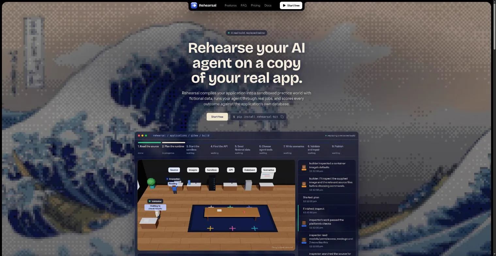
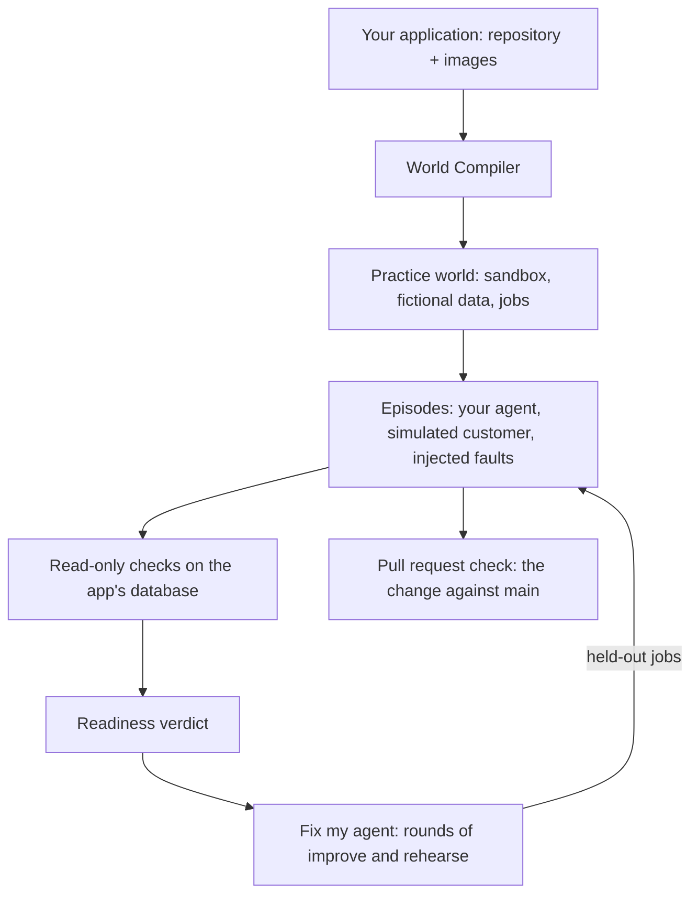

<div align="center">

<a href="https://rehearsalkit.xyz">
  
</a>

# Rehearsal

**Prove your AI agent works before it ships.**

Rehearsal is CI for AI agents. It runs your agent on a working copy of your real application, with fictional data, and decides every outcome by reading the application's own database. No model grades the result. No agent yet? Rehearsal writes one for your application, hardens it, proves it on jobs it has never seen, and hands it to you as a program you can run. When an agent fails, Rehearsal fixes it in rounds; when someone changes it, a pull request check catches regressions.

[](https://pypi.org/project/rehearsal-kit/)
[](https://pypi.org/project/rehearsal-kit/)
[](https://www.npmjs.com/package/rehearsal-kit)
[](https://github.com/MitudruDutta/rehearsal/actions/workflows/tests.yml)
[](https://docs.rehearsalkit.xyz)
[](LICENSE)

[Website](https://rehearsalkit.xyz) · [Documentation](https://docs.rehearsalkit.xyz) · [Quickstart](#quickstart) · [Built on Muse](#built-on-metas-muse-models) · [Self-hosting](#self-hosting) · [Planning docs](#planning-docs) · [Report a bug](https://github.com/MitudruDutta/rehearsal/issues)



</div>

## Why Rehearsal

An AI agent can tell you it finished the job while the records say otherwise. Most evaluations ask another model whether the transcript looks right, and a confident agent can talk its way to a pass.

Rehearsal tests the agent where it will actually work: on your application, through the same tools, with a customer who changes their mind and requests that fail on purpose. Pass or fail comes from read-only checks against the application's database, so "refund issued" only counts if the refund is there, exactly once.

## Features

- **World Compiler.** Point it at a repository and its published container images. It reads the source, starts the application in an isolated sandbox, seeds fictional data, chooses the tools each role may use, and writes jobs it proves can be passed and failed.
- **Grounded in real use.** Before it writes jobs, the compiler searches the web with Tavily for how real people use the application (its docs, forums and issue trackers) and bases at least half the jobs on the requests, rules and pitfalls it finds. Each job links the pages it came from.
- **Database-verified outcomes.** Every episode ends with read-only checks on the application's own records: goal reached, no duplicate side effects, claims that match the data.
- **Simulated customers.** Customers revise their request mid-task, so an agent that finishes the old request gets caught.
- **Failures on purpose.** Requests time out after the change already went through, so blind retries show up as duplicates.
- **Readiness verdict.** Ready to pilot, or not yet, with every measure linked to the episodes behind it.
- **Why it failed, in plain words.** Every failed episode gets named causes read from the records ("acted on the old request", "did the same thing twice", "said done but was not"), with counts, the usual fix and the episodes behind each. The fix loop targets the most common ones.
- **Agent Factory.** From a published world to a verified agent: Rehearsal drafts the agent from the world's tools, your policies and the research on real use, hardens it with the fix loop, proves it on held-out jobs, and packages it as a zip with a standalone `agent.py` (Muse Spark on the Meta Model API, calling your application's real API, asking before every change) and a `PROOF.md` with every score.
- **Fix my agent.** A loop that writes the next agent version from failed training jobs, rehearses it, and keeps it only if it verifies more episodes without breaking a rule. Rejected ideas are shown to the next round. The best version is then proved against the original on held-out jobs that no round has seen.
- **Pull request checks.** `rehearsal gate` and a GitHub Action rehearse a changed agent next to the version on `main` and fail the check on a broken rule or any regression.
- **Bring your own agent.** Describe an agent with instructions and a model, give the URL of your own agent (any OpenAI-compatible endpoint), or drive episodes from your own code in any language through the episode API.
- **Incidents become tests.** Describe something an agent got wrong in production; Rehearsal writes a validated job that puts an agent in the same spot, so every later evaluation and CI check catches it.
- **Ready-made worlds.** A world library lets any workspace rehearse agents on worlds that are already built, without building anything.
- **Builds that do not burn money.** Tools are checked one at a time, a stuck step pauses itself, the build page shows what each step cost and why it is stuck, and a deploy that restarts workers never costs a build an attempt.
- **Every step on the record.** Each build, rehearsal and improvement keeps its full timeline in Rehearsal: model calls, tool calls, checks, and what each one cost, broken down by role and model.
- **Meta's Muse models by default, any provider if you want.** Every role runs on Muse Spark or Muse Wonder through the Meta Model API, routed by role with its own reasoning effort, and falls back to the open weights of Muse Spark Open on Fireworks and Baseten. OpenAI, Anthropic, Google, Mistral, xAI, DeepSeek, Groq, Together, Cerebras, OpenRouter, a LiteLLM proxy, Modal, or any OpenAI-compatible endpoint also work, with fallback chains and spend caps.

## How it works



1. **Build a practice world.** The World Compiler turns an application into a versioned, resettable world. Each episode starts from the same snapshot.
2. **Rehearse the agent.** Your agent works through jobs while a simulated customer talks to it and faults are injected.
3. **Verify and fix.** Checks decide each outcome. The fix loop turns failures into better versions and keeps only the ones that verify more; the best one is proved on jobs it has never seen.
4. **Guard every change.** A pull request that touches the agent is rehearsed next to `main` before it merges.

## Built on Meta's Muse models

Rehearsal existed before the Meta Global AI Developer Hackathon. What changed for it is [listed below](#what-changed-for-the-meta-hackathon).

### How Rehearsal uses Muse

Every model call in Rehearsal goes to one of Meta's Muse models, through an OpenAI-compatible API. The roles need different things, so each role has its own model chain, and the `#effort` at the end of an entry becomes `reasoning_effort` on the request:

| Role | What it does | Default chain |
|---|---|---|
| World Compiler (most roles) | Reads the source, runs the app in a sandbox, seeds data, writes tools and checks | Muse Spark 1.3 at `medium` |
| Hard compiler roles | Designs jobs, investigates failed validations, repairs builds, audits jobs live | Muse Wonder 1.0 at `high`, then Muse Spark 1.3 at `xhigh` |
| Agent under test | Does the job through the application's tools | Muse Spark 1.3 at `medium` |
| Simulated customer | Talks to the agent, changes its mind mid-task | Muse Spark 1.3 at `minimal` |
| Improvement step (fix loop) | Writes the next agent version from failures | the hard-role chain |
| Packaged agent (Agent Factory) | The `agent.py` that Rehearsal hands you | Muse Spark 1.3 at `medium` |

When the Meta Model API fails or has no key, every chain falls back to the open weights of Muse Spark Open on Fireworks, then on Baseten.

- **Routed by role.** A chain is `provider:model[#effort]`, so `meta:muse-spark-1.3#minimal` is Muse Spark with the shortest reasoning pass. The next model in a chain takes over when one fails.
- **Reasoning only where it pays.** The simulated customer answers in one or two sentences on every turn, so it reasons at `minimal`. Muse Wonder is kept for the roles where a wrong answer costs a whole build.
- **Measured per role.** Every call records its role, model, effort, tokens, time and cost. The console shows a "Models by role" table for each build, run and fix loop, and `rehearsal prices` shows the price used for each configured model. Meta Model API prices are built in, so a spend cap holds from the first call.

### Which Meta product does what

| Meta product | Where Rehearsal uses it |
|---|---|
| Meta Model API (`https://api.meta.ai/v1`, `MODEL_API_KEY`) | The default provider for every role |
| Muse Spark 1.3 | Tool work, the agent under test, the simulated customer, and the packaged agent |
| Muse Wonder 1.0 | The hardest World Compiler roles and the fix loop |
| Muse Spark Open (open weights) | The fallback on Fireworks and Baseten, or on your own Modal endpoint through `MODAL_BASE_URL` |
| Muse Glimmer (open weights) | Can serve any role or the packaged agent on your own machine, through the `local` provider (vLLM or llama.cpp) |
| Muse Code | A bundle with the Rehearsal skill and MCP server, so Muse Code can build worlds and run rehearsals for you |

### Use Rehearsal from Muse Code

```bash
muse skills install agent-plugin/providers/muse-code/skills/rehearsal --scope user
```

Then copy the `mcp_servers` block from [agent-plugin/providers/muse-code/settings.json](agent-plugin/providers/muse-code/settings.json) into `~/.config/muse/settings.json` and start a new session. Ask Muse Code to build a world, run an evaluation, or explain a failed episode.

### How Rehearsal uses Tavily

[Tavily](https://tavily.com), the agentic search API, is used in three places.

1. **Research before jobs are written.** Jobs written from source code alone can drift from what users really do. So every build has a research phase: a researcher role (on Muse Spark) searches the web with the Tavily Search API and reads the best pages with the Extract API, then writes a brief of real user requests, documented rules and known pitfalls, each with its URL. The job planner must base at least half the jobs on that brief and may cite only pages the researcher was shown. For Gitea, 8 pages grounded 5 of the 9 jobs.
2. **Setup notes from the application's own docs.** Before the runtime is planned, the compiler finds the application's documentation site from its README and asks Tavily, limited to that site, how the project says to run it in Docker. The builder and the seeder can also search and read docs pages themselves.
3. **Errors that keep coming back.** When the same application error repeats during a build step (a failed start, a seed step, an image build), the compiler searches for that error the way a person would paste it into a search engine and hands what it finds to the model's next try. Rehearsal's own validation messages are never searched.

- **Reproducible.** Pages are read once, at build time, and frozen into the world version. Episodes never touch the live web, so the same world gives comparable results.
- **Visible.** The world page has a "Real-world research" tab, each job lists the pages it is based on, error lookups appear in the build log, and Tavily calls and credits appear in the "Models by role" table and count against the build's spend cap.
- **Safe with untrusted pages.** Page text is data, never instructions; the researcher can only search and read, cannot reach the sandbox or any secret, and every job it inspired passes the same five validation gates.
- **Optional.** Without `TAVILY_API_KEY`, research and lookups are skipped and builds work as before.

### What changed for the Meta hackathon

- **Every role moved to Meta's Muse models.** Muse Spark and Muse Wonder on the Meta Model API by default, with Muse Spark Open on Fireworks and Baseten as fallbacks.
- **Reasoning effort per role.** A chain entry now ends in `#minimal`, `#low`, `#medium`, `#high`, `#xhigh` or `#max`, sent as `reasoning_effort`, in place of a vendor-specific thinking switch.
- **Prices for the Meta Model API** built in, so `rehearsal prices`, spend caps and the "Models by role" table work without a pricing file.
- **The Agent Factory packages agents that run on Muse Spark.**
- **A Muse Code bundle** with the Rehearsal skill and MCP server.
- **Runs from source on one machine**, with no deployment setup; see [Self-hosting](#self-hosting).

Earlier changes are in [CHANGELOG.md](CHANGELOG.md).

## Quickstart

Install the client: the `rehearsal` CLI, the SDK and the MCP server. It comes in two editions with the same
commands and the same sign-in, and runs on any OS. Pick the one that matches your agent's language:

```bash
pip install rehearsal-kit          # Python 3.11 or newer: the CLI and the Python SDK
npm install -g rehearsal-kit       # Node.js 20 or newer: the CLI and the TypeScript SDK
rehearsal login                    # opens the console in your browser; approve the code shown
```

Without installing, `npx rehearsal-kit <command>` runs the same CLI. The server, workers and World Compiler are
Python only; see [Self-hosting](#self-hosting).

Build a world and evaluate an agent on the hosted service at [rehearsalkit.xyz](https://rehearsalkit.xyz):

```bash
rehearsal apps import-catalog                            # pinned open-source apps: Gitea, Chatwoot, Vikunja, WordPress, ...
rehearsal apps list                                      # note an application id
rehearsal build APP_ID --watch                           # compile a practice world (spends model budget)
rehearsal worlds list                                    # note the published world version id
rehearsal profiles create support-agent                  # add --prompt-file FILE for your own instructions
rehearsal eval WV_ID --profile PROFILE_ID --split dev --watch
rehearsal runs episode EPISODE_ID                        # actions, messages, and which checks failed
rehearsal factory WV_ID --name support-agent --watch     # no agent yet? Rehearsal writes, hardens and proves one
rehearsal autofix PROFILE_ID RUN_ID --rounds 3 --watch   # fix it in rounds, proved on held-out jobs
rehearsal gate WV_ID --prompt-file agent.md --name support-agent --baseline-file main-agent.md   # the CI check
```

In GitHub Actions, the same check is one step: `uses: MitudruDutta/rehearsal@main`. See [Use Rehearsal in CI](https://docs.rehearsalkit.xyz/guides/use-rehearsal-in-ci).

Add your own application by pinning its source commit and images:

```bash
rehearsal apps add my-app --git https://github.com/you/app --commit <full commit sha> \
  --image web=registry.example.com/app@sha256:<digest> --policies-file policies.md
```

<details>
<summary><b>Use it from Python</b></summary>

```python
from rehearsal.sdk import Rehearsal

rh = Rehearsal()  # your sign-in, or REHEARSAL_URL and REHEARSAL_API_KEY in CI
app = rh.applications.create(
    "my-app",
    {"kind": "git", "url": "https://github.com/you/app", "commit": "<sha>"},
    images={"web": "registry.example.com/app@sha256:<digest>"},
)
build = rh.worlds.build(app["id"])
rh.jobs.wait(build["job_id"])
```

To drive episodes with your own agent, read `rh.external.observation(episode_id)` and send tool calls with `rh.external.act(...)`. See [examples/agents/langgraph_react.py](examples/agents/langgraph_react.py) and [PACKAGE.md](PACKAGE.md).

</details>

<details>
<summary><b>Use it from TypeScript</b></summary>

The npm package has the same client, the same `rehearsal` command and the same MCP server, and uses the same sign-in:

```bash
npm install rehearsal-kit      # or: pnpm add rehearsal-kit / bun add rehearsal-kit
```

```ts
import { Rehearsal } from "rehearsal-kit";

const rh = new Rehearsal(); // your sign-in, or REHEARSAL_URL and REHEARSAL_API_KEY in CI
const app = await rh.applications.create(
  "my-app",
  { kind: "git", url: "https://github.com/you/app", commit: "<sha>" },
  { web: "registry.example.com/app@sha256:<digest>" },
);
const build = await rh.worlds.build(app.id);
await rh.jobs.wait(build.job_id);
```

Method names are the Python names in camelCase. See [rehearsal/ts/README.md](rehearsal/ts/README.md).

</details>

<details>
<summary><b>Use it from your AI assistant</b></summary>

Install the plugin for Claude Code (Codex works the same way with `codex plugin ...`):

```bash
claude plugin marketplace add MitudruDutta/rehearsal
claude plugin install rehearsal@rehearsal
```

Or add only the MCP server, from either package:

```bash
claude mcp add rehearsal -- uvx --from "rehearsal-kit[mcp]" rehearsal mcp   # Python, with uv
claude mcp add rehearsal -- npx -y rehearsal-kit mcp                        # Node.js
```

Then ask your assistant to build a world, run an evaluation, or explain a failed episode.

</details>

## Self-hosting

The server, workers and sandboxes run on Linux with Docker. The CLI and SDK run anywhere.

**Requirements:** Python 3.11–3.13, Docker (for the local database and the sandboxes), and a Meta Model API key (`MODEL_API_KEY`, from [dev.meta.ai](https://dev.meta.ai)) for the default Muse models, or a key for any other provider. Node 22 and pnpm 10 are needed only to build the console from source.

### From source

```bash
python -m venv .venv && source .venv/bin/activate
python -m pip install -e './rehearsal/py[server,dev]'
cp .env.example .env                                     # set REHEARSAL_SESSION_SECRET and MODEL_API_KEY
(cd web && pnpm install --frozen-lockfile && pnpm build) # build the console once

rehearsal up                                             # PostgreSQL in Docker on 127.0.0.1:5433, then migrations
rehearsal bootstrap                                      # prints the project id and an admin API key, shown once
export REHEARSAL_URL=http://127.0.0.1:7800 REHEARSAL_API_KEY=rh_...
rehearsal users add you@example.com --project prj_...    # a console login, password of 10+ characters

rehearsal serve                                          # API and console on http://127.0.0.1:7800
rehearsal worker                                         # builds and evaluations, in a second terminal
```

Generate the session secret with `python -c "import secrets; print(secrets.token_hex(32))"`. Keep keys in `.env`, which git ignores.

The [self-hosting guide](https://docs.rehearsalkit.xyz/self-hosting) covers requirements, installing from source, Windows and troubleshooting.

## Configuration

Settings come from the environment, or from `.env` in the working directory. The main ones:

| Variable | Default | Purpose |
|---|---|---|
| `REHEARSAL_DATABASE_URL` | local PostgreSQL on port 5433 | Control-plane database |
| `REHEARSAL_SESSION_SECRET` | development value | Signs console session cookies; set your own |
| `REHEARSAL_MODEL_COMPILER`, `_REASONER`, `_AGENT`, `_PARTICIPANT`, `_IMPROVER` | Meta's Muse models, routed by role | Model chains, `provider:model[#effort][,...]` |
| `MODEL_API_KEY` | none | Meta Model API, for the default Muse Spark and Muse Wonder models |
| `FIREWORKS_API_KEY`, `BASETEN_API_KEY` | none | Fallback hosts for the open weights of Muse Spark Open |
| `TAVILY_API_KEY` | none | Web research during builds; without it the research phase is skipped |
| `OPENAI_API_KEY`, `ANTHROPIC_API_KEY`, ... | none | One key for each other provider the chains name |
| `REHEARSAL_SIGNUP` | `open` | `closed` stops new workspaces from the sign-in page |
| `REHEARSAL_MONTHLY_ALLOWANCE_USD` | `0` (no limit) | Model spend a workspace may use per month |
| `REHEARSAL_URL`, `REHEARSAL_API_KEY` | `https://rehearsalkit.xyz`, none | Where the CLI and SDK connect |

Every setting, with its default, is in the [configuration reference](https://docs.rehearsalkit.xyz/reference/configuration). `rehearsal prices` shows the price the server uses for each configured model.

## Development

```bash
# Unit tests, no services needed
python -m pytest rehearsal/py/tests/unit -q

# Integration tests: need `rehearsal up` and, for the sandbox test, Docker
python -m pytest rehearsal/py/tests/integration

# Console: dev server on http://localhost:3000, proxying the API on port 7800
cd web && pnpm dev
cd web && pnpm typecheck
```

`pnpm build` writes the console's static export to `web/out` and copies it to `rehearsal/py/rehearsal/api/static`, where the API serves it. The documentation site lives in [docs/](docs/).

The repository holds two packages, released together under one version:

| Folder | Package | What it is |
|---|---|---|
| [rehearsal/py/](rehearsal/py/) | `rehearsal-kit` on PyPI | The server, workers and World Compiler, plus the Python SDK, CLI and MCP server. Its tests are in `rehearsal/py/tests/` |
| [rehearsal/ts/](rehearsal/ts/) | `rehearsal-kit` on npm | The TypeScript SDK, CLI and MCP server, for the same API. The server stays Python |

Run the TypeScript package's tests with `pnpm --dir rehearsal/ts install --frozen-lockfile && pnpm --dir rehearsal/ts test`.

## Planning docs

Rehearsal was planned before it was built, in three documents that build on each other:

| Document | What it settles |
|---|---|
| [Scope](docs/scope.md) | The problem, who it is for, the decisions from the planning interview, what is in and out of scope, and how success is measured |
| [Product requirements](docs/prd.md) | Users, journeys, numbered functional and non-functional requirements, acceptance criteria, and release status |
| [Technical specification](docs/spec.md) | Architecture, data model, the World Compiler, job validation, sandboxing, scoring, the job queue, interfaces, spending, and testing |

## Status

Rehearsal is in early release (0.1.x). World builds, evaluations, the fix loop, pull request checks and comparison work end to end. `rehearsal train` and `rehearsal run-bundle` exist but report that they are not implemented yet. A world build takes one to three hours and spends model budget; every job has a spend cap.

## Built with

- Meta's [Muse models](https://dev.meta.ai) (Muse Spark, Muse Wonder and the open-weight Muse Spark Open) run every role in Rehearsal, through the Meta Model API, Fireworks and Baseten.
- [Tavily](https://tavily.com) grounds every world in how real people use the application and helps builds past setup errors.
- FastAPI, SQLAlchemy and PostgreSQL for the control plane; Docker for sandboxes; Next.js for the console and documentation.

## Contributing

Issues and pull requests are welcome. Run the unit tests and the console typecheck before opening a pull request, and keep secrets out of commits: `.env` is ignored by git.

## License

MIT, an OSI-approved open source license. See [LICENSE](LICENSE).
